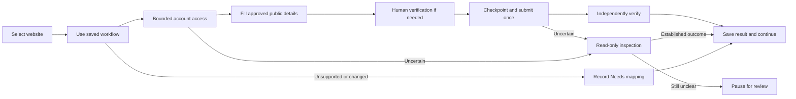

# Current publishing workflow

Operator decisions updated 2026-10-30. These rules supersede older handoff preferences. Read the actual campaign journal for current counts; the saved checkpoint is 83 verified websites.

## Final product requirement: no AI dependency

The finished tool must run without an AI provider, model API key, AI subscription or coding-assistant session. The existing Python publishing runner sends deterministic commands directly to the Ui.Vision bridge; the bridge protocol does not itself require an AI model. Regular Chrome/Ui.Vision and the independent Playwright verifier remain runtime components unless deliberately replaced later.

Every supported workflow must contain its navigation, field mapping, account handling, free-plan checks, receipt interpretation and independent public verification. A saved layout alone is not a finished publishing adapter. Unexpected pages must produce a recorded review/mapping state rather than depend on an AI guessing what to click. CAPTCHA and email verification remain operator actions.

AI-assisted development is separate from the final product's runtime. The operator selected a Windows app and separate maintenance of unsupported/changed workflows. The app marks those sites Needs mapping and continues; it does not require an AI or an in-app recorder to repair them.

## One normal entry point

Double-click **Start_Backlink_App.cmd** to open the Windows app. Select a completed client XLSX, connect Chrome, then click **Start / Resume**. See [DESKTOP_APP.md](DESKTOP_APP.md). Opening the app or loading a workbook does not publish.

The terminal launcher remains available:

```powershell
.\Start_Browser_Automation.ps1
```

The launcher uses `.local/workbooks/Cheer_Athletics_St_Louis.xlsx`, `websites/Website_Pool.xlsx`, campaign `default`, and the full-pool mode. It considers every enabled website even after 100 verified websites. `-StopAtTarget` restores the 100-result stopping limit; `-Only example.com` selects a website. Running the launcher publishes; changing documentation or previewing does not.

The assistant maps unsupported workflows as needed. The launcher itself runs implemented adapters; a pool row, template observation or saved blueprint alone does not implement publishing.

## Process

1. Load the approved workbook, pool, journal and confidence history. Preserve published/protected records.
2. Use an installed saved workflow and validate the actual free posting form. The desktop app marks unsupported/changed workflows Needs mapping and continues. Separate mapping maintenance can reuse exact confirmed layouts and asks about new/changed ones; it is not required during an ordinary app run.
3. Saved account workflows follow the bounded account policy: try workbook login once; only an explicit rejection can advance to recognized free registration. If the blog name exists, try A, B or C suffixes, at most three variants after explicit rejections. Do not try another username login. Keep email/password unchanged. An already-registered email, suspension or ban skips the website. Unsupported account forms need mapping rather than guessed actions.
4. Fill all suitable public client details, excluding credentials. Fit essentials first and report omissions. Free plans only; never invent reciprocal links or business facts.
5. Pause for operator CAPTCHA/email verification with one desktop notification and sound. Recheck before submitting. Save `submitting` before one final click.
6. Independently verify the public result. Count an eligible detail/category page only when it shows the business name and a visible clickable link to the exact approved destination. Count each public hostname once. Recover exact existing backlinks after duplicate rejections.
7. Save every outcome, including errors and skips, then continue through the pool. Clear website errors skip automatically.

## Uncertain results

Stop the active queue and inspect before moving on. Account inspection rereads the current page without navigation, typing or submission. Publishing inspection reads the current receipt, rechecks saved candidates and searches supported directories for an exact existing backlink. These same read-only resolution steps are reused on future occurrences; successful resolutions are recorded in the private account checkpoint or campaign journal.

If inspection establishes signed-in access, a rejection, pending moderation or a verified publication, continue from that established state. If it cannot establish a clear result, pause for the operator. The app supports rechecking, independently verifying a supplied public URL, or deferring the site while retaining its protected submission state. Inspection never authorizes another final click. A new, previously unknown correction still requires inspection and a validated mapping; the tool does not invent arbitrary repair actions.

Account attempts and blog-name variants are checkpointed privately before their clicks. Interruptions, uncertain registrations and older login checkpoints stay protected. Do not clear these files to force another attempt. Existing pending/uncertain publications are never blindly reposted.

## Files to use

| Purpose | File |
|---|---|
| Approved data and supplied credentials | `.local/workbooks/Cheer_Athletics_St_Louis.xlsx` |
| Expandable website list | `websites/Website_Pool.xlsx` |
| Confirmed layouts and source evidence | `mappings/layouts/<hostname>.json` |
| Private account checkpoints | `.local/site-access/<hostname>.json` |
| Verified public URLs only | `output/cheer-athletics-st-louis-97799292ece7/published_urls.txt` |
| Every publication outcome and error reason | `output/cheer-athletics-st-louis-97799292ece7/results.csv` |
| Campaign checkpoint and progress | Same output folder: `state.json`, `progress.json`, `attempts.sqlite3` |

The campaign has one active results CSV: `results.csv`. Its `published_url` column contains verified public URLs; pending/error rows have no verified URL. If Excel locks it, close the workbook when prompted so the same file can update. No alternate result CSV or URLs-only CSV is generated. Older fallback copies are preserved privately in `.local/report-backups/` ZIP archives.



## Legacy account checkpoint resolution (2026-10-30)

The operator authorized one fresh login on sites with older unresolved login checkpoints and unexplained rejected registrations. Preserve the old checkpoint and journal the new action separately before submitting. This exception applies once per site, never repeats a fresh uncertain action, pauses for CAPTCHA, and skips confirmed bans or suspensions.

## Paste-ready client workbook

The default generated template now matches the citation source's first eight rows on Business (A1:B8), with shared credentials once on Account and optional per-site differences on Overrides. Sites has only Listing site and Enabled. Leave Sites blank to use the project pool. Business B7 accepts multiline source hours; B9 contains optional ordered fallback categories. Legacy workbooks remain supported. The reader validates hours and formulas before publishing; shared credentials are applied to new pool sites without appearing in public content. See OPERATING_GUIDE.md for the exact cells.

## Category review and reusable choices (2026-10-31)

Capture every available dropdown option, including hierarchy labels, values, disabled flags and placeholders. Save versioned inventories and the selected option with its reason under `mappings/category_options/`. Clear matches proceed automatically. If deterministic matching is ambiguous, stop before final submission for assistant AI review of the actual choices; the operator permits an accurate broader category when no specific one exists. Save approved decisions in `mappings/category_rules.json`, scoped to the primary category and ordered fallbacks, and validate the chosen label/value against live enabled options on reuse. No AI model is required in the runtime. The single campaign results.csv includes selected_category, category_value, category_reason and category_options_file. No category selection is evidence of publication.

## Multi-business classifieds routes (2026-10-31)

The shared classifieds adapter selects a business-topic route, rather than assuming sports. Automotive/battery/roadside categories use Services > Motors, confirmed on the live GetAdsOnline form. Sports retains Services > Health & Fitness. Both Ui.Vision and Playwright validate each actual link before navigation; missing or ambiguous links require mapping instead of publishing under an unrelated category. Structured City, State/Region and Country fields are supported even when the full address omits the country. Complete category-link inventories and the selected path are saved in mappings/category_routes/. No paid promotion is selected.
